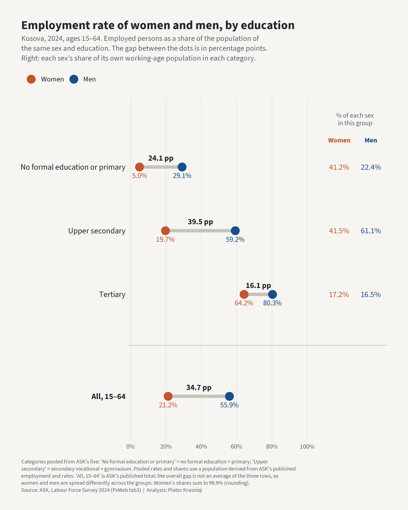

# Punësimi i grave dhe arsimi — Women's employment and education in Kosova

An accounting split of the gap between women's and men's employment in Kosova by education level, from ASK's Labour Force Survey 2024, checked against the 2024 census.

**In 2024, 21.2% of women aged 15–64 in Kosova were employed, against 55.9% of men: a gap of 34.7 percentage points. Differences in education level between women and men account for about 7% to 16% of that gap, depending on whether men's or women's education mix is the reference (an accounting split, not a causal effect). In the 2024 census the same split gives about 12% to 16% at ages 15–64 and 15% to 16% at ages 25–64 (the 25–64 band leaves out most students).**

The ranges show the choice of reference, not sampling error, which cannot be estimated from published tables. Each share is of the gap rebuilt from the three education groups (34.6 points in the LFS, against the published 34.7) and is computed from unrounded inputs; on either base the LFS range rounds to the same whole numbers.

Two different questions sit behind this, and they have different answers. **How does women's employment vary with education?** A great deal: 5.0% of women with no formal or primary education are employed, against 64.2% of women with tertiary education, though the groups also differ in age: the lowest group includes teenagers still in school. **How much of the gap between women and men do differences in their education account for?** A minority of it. Women and men are spread differently across education levels (in the LFS, 41.2% of working-age women and 22.4% of men are in the lowest group), but the difference lies mainly between the two lower groups, where women's employment is low in both (5.0% and 19.7%). Women are slightly more likely than men to have tertiary education (17.2% against 16.5%, LFS). Within each of the three pooled education groups the gap stays large, from 16.1 points (tertiary) to 39.5 points (upper secondary). Neither fact says what would happen to women's employment if their education changed; that is not identified here.



## The question

Women in Kosova are far less likely to be employed than men. Women are also more often in the lowest education group. This piece asks how much of the employment gap that difference accounts for in an accounting sense, by comparing women and men within the same education level and splitting the overall gap into a part *within* education levels and a part from the different *composition* of women and men across levels. The split is an accounting identity on published 2024 figures. It is not a model of why anyone is or is not employed.

## Data sources (all open)

All from ASK (Agjencia e Statistikave të Kosovës), ASKdata PxWeb, English node. Sources accessed 2026-10-23 to 2026-10-24 (UTC), as recorded in `data/raw/_download_log.csv`.

- **Labour Force Survey, annual tables** (Labour market > Anketa e Fuqisë Punëtore > Annual labour market):
  - `tab3.px` — employment ('000s) and employment-to-population ratio (%), by education attainment and sex, age group 15–64. The headline table.
  - `tab0.px` — population by sex and age group (checks the derived population).
  - `tab1b.px` — main labour-market indicators (checks the headline rates).
  - `tab20.px` — unemployment by education and sex (used only for the participation limitation).
  - `tab29.px` — accuracy of the national headline estimates.
- **Census 2024**:
  - `lc06ensus.px` (Census population > 4_Labour market) — employed by gender, education level and age group.
  - `tabcensusedu1.px` (Census population > 2_Education) — population aged 15 and over by educational attainment, gender and age.
  - `census2024_00.px` (Census population > 1_Demographic_Characteristics) — population by age and sex (checks the census universe).
- **ASK documents** on how the LFS series was produced (annual and quarterly LFS reports, and ASK's LFS metadata as catalogued by IHSN), cited by page in the appendix. They are downloaded by `R/01_e2_lfs_detail_check.R` and not redistributed here.

Deliberately excluded:

- `lc07ensus.px` (employed by education and five-year age group). Its sex labels contradict `lc06ensus.px`; see Limitations.
- LFS microdata. They are not published, so no cell-level standard errors or finer controls are possible.

## Definitions

- **Employment rate**: employed persons as a share of the population of the same sex (and, in the tables by education, the same education level). ASK calls this the employment-to-population ratio. Ages 15–64, 2024.
- **Three education groups**, pooled from ASK's five categories: *No formal education or primary* = no formal education + primary; *Upper secondary* = secondary vocational + gymnasium; *Tertiary* = tertiary. ASK's "Primary" has no separate lower-secondary category, and the five categories sum exactly to the total, so lower-secondary completers are almost certainly in "Primary"; ASK publishes no ISCED mapping that confirms it. In the census tables the lowest group does include the 8/9-grade lower-secondary rows (checked in `R/01_e3_age_check.R`).
- **Population by education** is not published in `tab3`. It is derived as employment ÷ (rate ÷ 100). ASK rounds rates to one decimal, so each derived population is known only within a rounding interval; the guards in `R/03_build_pooled_e.R` work with that interval.
- **The gap** is men's rate minus women's rate, in percentage points. The headline 34.7 points is ASK's published total row. The split below uses the gap recomputed from the three pooled groups, 34.63 points.

## Method

Scripts run in this order from the piece root. The numbering has gaps (no 02, 06, 07) because the scripts keep the numbers of the working folder they were developed in.

1. **`R/01_e_lfs_gender_check.R`** — pulls the LFS tables and checks them: categories add up to totals, men + women = total, the derived population against `tab0`, cell sizes.
2. **`R/01_e2_lfs_detail_check.R`** — reads the table metadata, compares `tab3` with ASK's printed 2024 report, and locates ASK's own statements about breaks in the series, with page numbers.
3. **`R/01_e3_age_check.R`** — scans the metadata of every LFS and census table for an education × age × sex breakdown, and finds the `lc07ensus` contradiction.
4. **`R/03_build_pooled_e.R`** — builds the three pooled groups: pooled rate = summed employed ÷ summed derived population; each sex's share of its working-age population per group.
5. **`R/04_decompose_e.R`** — splits the gap into a within-level and a composition part under three weightings (below).
6. **`R/04b_census_check_e.R`** — rebuilds the same three groups from the census (`lc06ensus` over `tabcensusedu1`) for two age bands, and repeats the split.
7. **`R/05_figure_e.R`** — the lead figure, rendered once at full size and downscaled for LinkedIn.
8. **`R/08_methods_note.R`** — writes this README from `data/processed/figures.json`.

The `01_` scripts write their own check tables and plots to `checks/`, which is not published; the numbers this README quotes from them are copied into `figures.json`.

**The split.** With *s* each sex's share of its working-age population in an education group and *r* the employment rate in that group, the gap between men (m) and women (f) is

G = Σ s_m·r_m − Σ s_f·r_f.

It splits into a part *within* education levels, a weighted average of the within-level gaps, and a *composition* part, from women and men being spread differently across levels. Which weights to use is a choice, not a measurement, so all three standard choices are reported and the result is a range:

- within = Σ s_m (r_m − r_f), composition = Σ (s_m − s_f) r_f;
- within = Σ s_f (r_m − r_f), composition = Σ (s_m − s_f) r_m;
- within = Σ ½(s_m + s_f)(r_m − r_f), composition = Σ (s_m − s_f) ½(r_m + r_f).

Each adds up to G exactly. The difference between the first two is the interaction of the two parts; the third splits it evenly.

"Controlling for education" here means only this: comparing women and men within the same one of three broad education groups, then averaging those within-group gaps. That average is the within part; the headline reports the other part, the composition part. Whatever differs between women and men inside a group, such as age, field of study, region or family situation, stays in the within part. The average depends on whose education mix supplies the weights, which is why there is a range.

## Key results

**Employment rate by education, ages 15–64, 2024** (LFS):

| Education (pooled) | Women, % | Men, % | Gap, points | % of women in group | % of men in group |
|---|---|---|---|---|---|
| No formal education or primary | 5.0 | 29.1 | 24.1 | 41.2 | 22.4 |
| Upper secondary | 19.7 | 59.2 | 39.5 | 41.5 | 61.1 |
| Tertiary | 64.2 | 80.3 | 16.1 | 17.2 | 16.5 |
| **All, 15–64** (ASK's published total) | 21.2 | 55.9 | 34.7 | — | — |

The gap within upper secondary (39.5 points) is larger than the overall gap (34.7 points). Rates and gaps are rounded to one decimal; a gap is computed before rounding.

**Within/composition split, LFS 15–64** (gap recomputed from the three groups: 34.63 points):

| Within-level gaps weighted by | Composition valued at | Within levels, points | Composition, points | Composition, % of gap |
|---|---|---|---|---|
| men's education mix | women's rates | 32.19 | 2.44 | 7.0 |
| women's education mix | men's rates | 29.13 | 5.50 | 15.9 |
| the average of the two mixes | the average of the two | 30.66 | 3.97 | 11.5 |

The composition part is 2.4 to 5.5 points, 7.0% to 15.9% of the gap, depending on the weighting. The within-level part is 29.1 to 32.2 points. Shares are computed from unrounded inputs; rebuilding them from this rounded table gives slightly different decimals.

With ASK's five unpooled categories instead of three groups, the same split gives a composition part of 2.5 to 5.7 points, 7.3% to 16.4% of a rebuilt gap of 34.63 points.

**Census check.** The same three groups, from the 2024 census, for ages 15–64 and, to leave out most students, 25–64. The census measures employment differently from the LFS (activity status at the census reference date, against the ILO definition averaged over a year-round survey), so its levels differ, mainly for women.

| Source, ages | Category | Women, % | Men, % | Gap, points |
|---|---|---|---|---|
| LFS, 15–64 | No formal education or primary | 5.0 | 29.1 | 24.1 |
| LFS, 15–64 | Upper secondary | 19.7 | 59.2 | 39.5 |
| LFS, 15–64 | Tertiary | 64.2 | 80.3 | 16.1 |
| LFS, 15–64 | All | 21.2 | 55.9 | 34.7 |
| Census, 15–64 | No formal education or primary | 8.2 | 30.9 | 22.7 |
| Census, 15–64 | Upper secondary | 31.9 | 58.9 | 27.0 |
| Census, 15–64 | Tertiary | 68.0 | 82.1 | 14.1 |
| Census, 15–64 | All | 28.5 | 54.9 | 26.3 |
| Census, 25–64 | No formal education or primary | 9.3 | 41.2 | 31.9 |
| Census, 25–64 | Upper secondary | 32.5 | 62.4 | 29.9 |
| Census, 25–64 | Tertiary | 70.2 | 83.6 | 13.4 |
| Census, 25–64 | All | 30.2 | 61.8 | 31.6 |

**Composition share in all nine combinations** (three source and age-band versions × three weightings):

| Source, ages | Within-level gaps weighted by | Composition, points | Gap rebuilt from three groups, points | Composition, % of gap |
|---|---|---|---|---|
| LFS, 15–64 | men's education mix | 2.44 | 34.63 | 7.0 |
| LFS, 15–64 | women's education mix | 5.50 | 34.63 | 15.9 |
| LFS, 15–64 | the average of the two mixes | 3.97 | 34.63 | 11.5 |
| Census, 15–64 | men's education mix | 3.07 | 26.39 | 11.6 |
| Census, 15–64 | women's education mix | 4.14 | 26.39 | 15.7 |
| Census, 15–64 | the average of the two mixes | 3.61 | 26.39 | 13.7 |
| Census, 25–64 | men's education mix | 5.07 | 31.70 | 16.0 |
| Census, 25–64 | women's education mix | 4.75 | 31.70 | 15.0 |
| Census, 25–64 | the average of the two mixes | 4.91 | 31.70 | 15.5 |

Each share is of that version's own gap rebuilt from the three groups. It differs from the published LFS total by rounding (-0.07 points) and from the census total rows by the Other/Unknown rows left out (+0.07 and +0.08 points).

Across all nine the composition part is 7.0% to 16.0% of the gap: less than a fifth every time. In the census alone it is 11.6% to 16.0%.

Which reference gives the larger composition part is not fixed. In the census at 25–64, weighting by men's mix gives the larger one (5.07 against 4.75 points); in the other two versions it gives the smaller.

## Reproduce

R ≥ 4.5.0. Packages: `dplyr`, `tidyr`, `readr`, `purrr`, `stringr`, `tibble`, `ggplot2`, `jsonlite`, `pxweb`, `pdftools`, `showtext`, `magick`.

From the `gender-employment-gap/` folder:

```
Rscript R/01_e_lfs_gender_check.R
Rscript R/01_e2_lfs_detail_check.R
Rscript R/01_e3_age_check.R
Rscript R/03_build_pooled_e.R
Rscript R/04_decompose_e.R
Rscript R/04b_census_check_e.R
Rscript R/05_figure_e.R
Rscript R/08_methods_note.R
```

The PxWeb extracts are committed in `data/raw/` and are not re-downloaded. The ASK reports and IHSN metadata are downloaded on the first run (2-second pause between requests) and kept locally; they are not committed.

## Outputs

- `data/processed/figures.json`
- `data/processed/e_lfs_education_sex.csv`
- `data/processed/e2_latest_full_table.csv`
- `data/processed/e3_pooled_2024.csv`
- `data/processed/e3_decomposition_2024.csv`
- `data/processed/e3_within_contributions_2024.csv`
- `data/processed/e4_census_2024.csv`
- `data/processed/e4_census_decomposition_2024.csv`
- `data/processed/e4_census_mapping.csv`
- `data/processed/e4_census_other_unknown_2024.csv`
- `data/processed/e4_composition_share_2024.csv`
- `output/employment_gap_by_education_2024.png`
- `output/employment_gap_by_education_2024_linkedin_1200.png`
- `README.md`, `output/catalogue_row.md` (from `R/08_methods_note.R`)
- `checks/` (verification tables and plots from the `01_` scripts; not published)

## Limitations

- **No causal claim.** The split is accounting: it says how much of the gap the different education mix of women and men accounts for, under one set of weights at a time. It does not say what would happen if women's education changed. Age, place of residence, family situation and who goes on to study all differ between these groups, and these tables cannot separate them. Whether education and employment are causally linked is not identified here.
- **What the within-level gap is.** It may include discrimination, preferences, care responsibilities, and differences in age, region or field of study. These data cannot tell them apart, and the gap is not a measure of any one of them.
- **Age band.** Ages 15–64 include young people still in education: teenagers still in school sit in the lowest group and count as not employed. In the census the gap is 26.3 points at 15–64 and 31.6 points at 25–64, and the composition share at 25–64 (15% to 16%) sits at the top of the LFS range. The headline uses 15–64 because ASK publishes no LFS table crossing education, age and sex: of the 104 LFS and census tables scanned, the seven that do are all census tables.
- **Three broad levels.** "Education" here means three groups. Years of schooling, vocational against general tracks, field of study and quality are not observed. With ASK's five unpooled categories the composition share is 7.3% to 16.4% (Key results), and one ordering changes: the gap for *No formal education* alone (14.5 points) is smaller than the tertiary gap (16.1).
- **The LFS and the census give different education mixes.** At 15–64 the share of each sex in a group differs between the two sources by up to 9.6 points (upper secondary: women 41.5% in the LFS against 31.9% in the census; men 61.1% against 51.6%). The LFS 2024 weighting base equals the census population, but its education mix does not match the census. The reason is not established here; the shares are the direct input to the composition part.
- **Employment combines participation and unemployment.** In the LFS, 25.8% of women and 60.6% of men aged 15–64 are in the labour force (employed or unemployed), and the unemployment rate is 18.0% for women and 7.7% for men. The employment gap contains both; this piece does not split them.
- **Emigration.** Emigration, which may differ by sex and education, shapes who is in the resident population that these tables describe. These tables do not measure it.
- **No trend.** Only 2024 is used. ASK's documents and the series itself show breaks that make earlier years hard to compare; they are listed in the appendix below.
- **`lc07ensus` contradicts `lc06ensus`.** At ages 15–64, `lc07ensus` labels 151,876 employed as men and 291,488 as women; `lc06ensus` has the same two numbers the other way round (291,488 men, 151,876 women). Read with its own labels, `lc07ensus` has one cell where employment exceeds population (upper secondary, women 25–64: 126,778 employed against 109,966 people). `lc07ensus` is therefore not used. The census check depends on `lc06ensus` having the correct labels; that agrees with every other source checked, but ASK has not confirmed it (tables last updated 2026-04-22 and 2026-04-20).
- **LFS and census measure different things.** The census counts 443,364 employed aged 15–64; the LFS 414,493. Women's employment rate is 28.5% in the census and 21.2% in the LFS. The census check tests whether the pattern holds, not the level.
- **Census universes.** The census education table (`tabcensusedu1`) covers 11,017 fewer people aged 15–64 (1,063,687) than the census population table (`census2024_00`, 1,074,704; also the LFS 2024 weighting base). Census rates therefore combine two slightly different populations: employed from `lc06ensus`, whose universe is not stated, over population from `tabcensusedu1`. If the employed come from the larger universe, census rates are too high by up to about 1.0% of their value.
- **Census residual categories.** "Other" and "Unknown" education are left out of the census groups. At 15–64: women 800 employed (0.53% of the sex's employed), 2,232 people (0.42%); men 1,150 employed (0.39% of the sex's employed), 2,476 people (0.47%). At 25–64: women 666 employed (0.54% of the sex's employed), 1,349 people (0.33%); men 970 employed (0.39% of the sex's employed), 1,666 people (0.42%).
- **Northern municipalities.** The census figures include 1,333 employed aged 15–64 in the four northern municipalities, as published. Whether these are enumerated persons or include ASK's estimates is not stated in the table. Coverage of the north by the LFS sample is not stated; the LFS weighting base equals the census total including the north, so if the north is not sampled, its population is represented by respondents elsewhere.
- **Sampling.** The LFS is a sample survey. ASK publishes reliability only for the national headline rates (coefficient of variation of the 15–64 employment rate: 1.20%), not for education × sex cells. The smallest cell is No formal education, female (0.3 thousand employed); pooling with "Primary" limits its weight.
- **Derived populations.** The derived population summed over the five categories differs from ASK's published 15–64 population by -0.27% (women) and -0.03% (men), and the overall gap recomputed from the three groups differs from the published one by -0.07 points; both are within the rounding of the published rates.

## Appendix: breaks in the LFS series

Not used in the results, which are for one year only. Recorded so that the 2024 figures are not compared with earlier years without care. From ASK's own documents:

- 2012 redesign: Eurostat methodology, continuous survey, new frame from the 2011 census: [ASK, *Anketa e Fuqisë Punëtore 2024*](https://askapi.rks-gov.net/Custom/085719f6-0ef0-4365-afa7-9a02c8d10cf5.pdf), p. 3.
- 2012: sample phased in quarter by quarter; weights computed per quarter: [ASK LFS 2012 metadata (IHSN catalogue, DDI export)](https://catalog.ihsn.org/metadata/export/7242/ddi), p. 1.
- 2013/2014: weights adjusted to a projected population total: [ASK LFS 2014 metadata (IHSN catalogue, DDI export)](https://catalog.ihsn.org/metadata/export/7244/ddi), p. 1.
- 2013: a similar adjustment, to a projection variant: [ASK LFS 2014 metadata (IHSN catalogue, DDI export)](https://catalog.ihsn.org/metadata/export/7244/ddi), p. 1.
- 2020 Q2: field collection stopped for three months (non-response): [ASK, *Anketa e Fuqisë Punëtore 2021*](https://askapi.rks-gov.net/Custom/d483c4e9-d88b-4c56-b888-4a05f5fff76e.pdf), p. 16.
- 2020-21: new law barred external interviewer staff; collection later covered the preceding months retrospectively: [ASK, *Anketa e Fuqisë Punëtore 2021*](https://askapi.rks-gov.net/Custom/d483c4e9-d88b-4c56-b888-4a05f5fff76e.pdf), p. 16.
- 2020 Q4: households refusing contact were interviewed by phone: [ASK, *Labour Force Survey Q4 2020*](https://askapi.rks-gov.net/Custom/2c09a68c-35f9-4131-9c66-beb6255acfb0.pdf), p. 11.
- 2022 H1: two further one-month interruptions of field interviews: [ASK, *Anketa e Fuqisë Punëtore 2021*](https://askapi.rks-gov.net/Custom/d483c4e9-d88b-4c56-b888-4a05f5fff76e.pdf), p. 16.
- From March 2022: re-interviews by telephone (CATI): [ASK, *Anketa e Fuqisë Punëtore TM3 2022*](https://askapi.rks-gov.net/Custom/9bee491c-a7bb-477d-a86c-a5f1f049dab8.pdf), p. 10.
- Panel design: delays in collection affect the quality of published data: [ASK, *Anketa e Fuqisë Punëtore TM3 2022*](https://askapi.rks-gov.net/Custom/9bee491c-a7bb-477d-a86c-a5f1f049dab8.pdf), p. 10.
- 2021 report: interviews described as CAPI only: [ASK, *Anketa e Fuqisë Punëtore 2021*](https://askapi.rks-gov.net/Custom/d483c4e9-d88b-4c56-b888-4a05f5fff76e.pdf), p. 7.
- 2023 report: first interviews CAPI, re-interviews CATI: [ASK, *Anketa e Fuqisë Punëtore 2023*](https://askapi.rks-gov.net/Custom/d8b6019c-eccf-419f-a5b0-9fb7df247ce3.pdf), p. 6.
- 2023 report: population base 'estimated' for 2023: [ASK, *Anketa e Fuqisë Punëtore 2023*](https://askapi.rks-gov.net/Custom/d8b6019c-eccf-419f-a5b0-9fb7df247ce3.pdf), p. 15.
- 2024 report: population base from the 2024 census: [ASK, *Anketa e Fuqisë Punëtore 2024*](https://askapi.rks-gov.net/Custom/085719f6-0ef0-4365-afa7-9a02c8d10cf5.pdf), p. 12.

In the data:

- ASK's working-age population (`tab0`) moves from 1,171.8 thousand in 2023 to 1,074.7 thousand in 2024 (-8.3%), against changes of at most 2.9% a year in earlier years; the 2024 base equals the census total (1,602,515).
- The split between vocational and general secondary education jumps in 3 years with no explanation found: 2019 (vocational +9.3, gymnasium -11.0 pp); 2021 (vocational -11.5, gymnasium +10.3 pp); 2022 (vocational -9.6, gymnasium +11.3 pp). The pooled upper-secondary group is stable across those years, which is one reason the two are pooled.
- No ASK LFS documentation was found for 2015, 2016, 2017, 2018, 2019.

## Licence and reuse

Kosova, all ASK data: Kosovo Agency of Statistics (KAS), licensed under CC BY 4.0 (https://creativecommons.org/licenses/by/4.0/; terms: https://ask.rks-gov.net/AboutUs/author-rights, retrieved 2026-10-31). Modified: education categories pooled; populations derived from published employment and rates. No endorsement by KAS is implied. The repository licence covers the code only.

Design, decisions and verification by the author; code written with AI assistance (Claude Code). One independent cold-context review was run before publication; its points were assessed one by one and the accepted ones applied in this version.

---

*Data: ASK (Kosovo Agency of Statistics), Labour Force Survey and Census 2024, via ASKdata. Analysis: Plator Krasniqi.*
