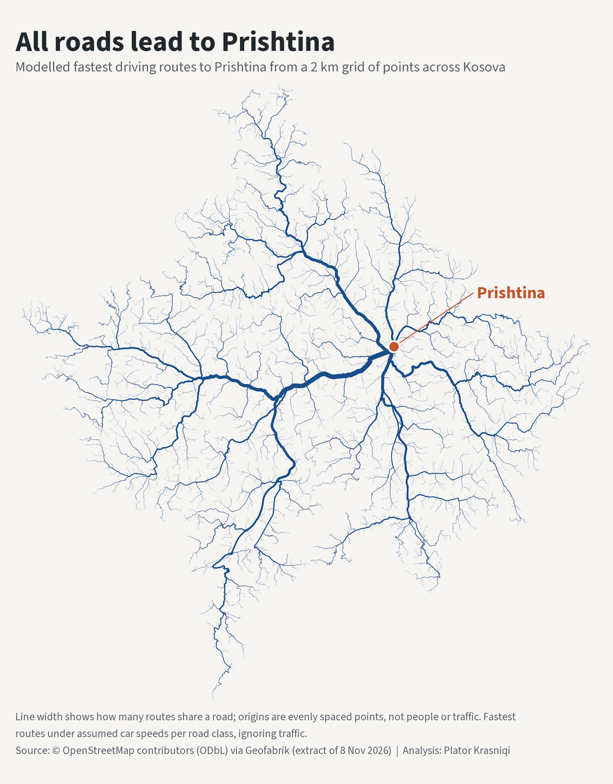

# Të gjitha rrugët të çojnë në Prishtinë — All roads lead to Prishtina

A map of modelled fastest driving routes to Prishtina from evenly spaced points across Kosova, built on the road network from OpenStreetMap, routed in R with dodgr.

**The figure draws the modelled fastest driving route to Prishtina from 2,580 of the 2,717 points of a 2 km grid over Kosova, and draws a road thicker the more of those routes share it. It carries no statistic: it shows the shape of the road network as seen from one destination under one fixed set of speed assumptions.**



## What the figure shows

Each line is a piece of road used by at least one modelled route to Prishtina; 268,576 directed network edges are drawn. A route starts at a grid point, is moved to the nearest point of the road network, and follows the fastest path to one destination point in Prishtina under an assumed speed for each class of road. Where routes from many points join the same road, the line gets wider, so the widest lines are the roads shared by the most starting points, not the roads with the most vehicles. All routes end at the same point by construction, so the lines get wider towards Prishtina whatever the network looks like. No boundary is drawn; the extent of the lines follows the polygon used to place the grid points, since only points inside it are origins. Prishtina is the only label.

## Data sources (all open)

- **Roads:** © OpenStreetMap contributors, Open Database Licence (ODbL) 1.0, <https://www.openstreetmap.org/copyright>, via Geofabrik (download.geofabrik.de > Europe > `kosovo-261108.osm.pbf`). Extract of 8 November 2026, 30,852,425 bytes, MD5 `3da99cd00efa35fc5b6a9eacd3c72825`; the local file matches the MD5 that Geofabrik publishes beside it. Geofabrik's file name is kept as published.
- **Polygon for placing origins:** geoBoundaries gbOpen, `XKX` ADM0 (wmgeolab/geoBoundaries > releaseData > gbOpen > XKX > ADM0), pinned to commit `9469f09592ced973a3448cf66b6100b741b64c0d`, file MD5 `26344328c84503f89b0564a071356b77`. Its metadata file gives the licence as "Creative Commons Attribution-ShareAlike 2.0" and the source as "Open Street Map". The polygon decides which grid points are origins and is not drawn.
- **Sanity check only, not an input:** one driving distance and time read from Google Maps on 10 November 2026 (Method, step 9). Nothing from Google Maps enters the routes or the figure.
- Raw downloads and processed data are not committed; the scripts regenerate them.

## Method

Every item below is an analyst choice unless it says otherwise.

1. **Origins: a 2 km grid clipped to the country polygon.** Grid centres are laid out every 2 km in UTM zone 34N over the polygon's bounding box; the 2,717 centres inside the polygon are the origins. They are evenly spaced points and carry no population weight.
2. **Destination: one point.** The destination is the OpenStreetMap place node for the city (node `2885136501`, at 42.66388° N, 21.16408° E), moved 73 m to the nearest vertex of the road network (42.66374° N, 21.16496° E). Every route ends at that vertex.
3. **Road classes and access.** 77,347 OSM ways in 13 `highway` classes are read (the classes in the table below); service roads and tracks are left out. Of these, 190 ways tagged `access=private` (162), `access=no` (27) or `access=military` (1) are removed, which leaves 77,157 ways.
4. **Snap cap of 2 km.** An origin more than 2 km from a road of the routable network is dropped: 135 origins. Each remaining origin is moved to its nearest network vertex, with distances measured in metres in UTM zone 34N; the largest move is 1,999 m, and the script stops if any origin moves more than 2 km. 2 origins sit on a vertex with no directed path to the destination and are reported as unreachable. 2,580 origins are routed (135 + 2 + 2,580 = 2,717).
5. **Speeds: dodgr's fixed car profile.** Every road runs at the speed that dodgr 0.5.0 assigns to its class in the `motorcar` profile, shown below. These are assumed speeds. OSM `maxspeed` and `surface` tags are not used. The script asserts that every edge of the graph runs at exactly its class speed.

| OSM road class (`highway`) | Assumed speed, km/h |
|---|---|
| `motorway` | 90 |
| `trunk` | 85 |
| `primary` | 65 |
| `secondary` | 55 |
| `tertiary` | 40 |
| `unclassified` | 25 |
| `residential` | 25 |
| `living_street` | 10 |
| `motorway_link` | 45 |
| `trunk_link` | 40 |
| `primary_link` | 30 |
| `secondary_link` | 25 |
| `tertiary_link` | 20 |

6. **No turn or traffic penalties.** The fastest route is the path with the lowest total of (length ÷ class speed). There is no delay for turns, junctions or traffic lights, and no traffic.
7. **One-way streets and roundabouts.** One-way tags are kept. Before the graph is built the script sets three cases itself: 2 ways tagged `oneway=-1` (one-way against the drawn direction) have their geometry reversed and are set to one-way; 198 roundabouts and 0 circular junctions without a one-way tag are set to one-way. The script stops on any other `oneway` value. It then checks the first segment of every way: a one-way way must be in the graph in its drawn direction only, a two-way way in both directions.
8. **Disconnected fragments dropped.** Only the largest connected part of the network is routed. It holds 98.89% of the network's directed edge length; 211 smaller fragments make up the rest and are dropped, not patched.
9. **Sanity check on one distance.** Before any grid routing, the distance along the model's fastest path from Prizren to Prishtina is compared with the Google Maps driving distance for the same pair: 79.8 km in the model against 84 km in Google Maps (read on 10 November 2026), a ratio of 0.95. The tolerance is ±10%; outside it the script stops. The check compares distance only, not travel time. Anchors are the OSM place nodes of the two cities.
10. **Line width and colour.** Width follows the square root of the number of routes on an edge, between 0.06 and 2.6 ggplot2 line-width units. Colour is opaque: an edge with one route is drawn in a mix of 55% navy and 45% background, the mix reaches full navy at 20 routes per edge on a log scale, and stays navy above that. Heavier edges are drawn on top. These are drawing choices for legibility.
11. **Label.** The label sits in the nearest area with no line under it and is joined to the destination by a leader line; its position is a drawing choice.

## Key results

These describe the model run, not travel in Kosova.

- 2,580 of 2,717 grid points (95.0%) are routed; 135 are dropped for lying more than 2 km from a routable road and 2 are unreachable.
- 268,576 of the 1,760,864 directed edges of the routed network (15.3%) carry at least one route.
- The median modelled route is 61 km long and takes 55 minutes at the assumed speeds; the longest is 144 km and 135 minutes.
- The Prizren–Prishtina check gives 79.8 km in the model against 84 km in Google Maps.

## Reproduce

R version 4.5.1 (2025-06-13 ucrt), dodgr 0.5.0. The full package list and the GDAL, PROJ and GEOS versions are in [`output/session_info.txt`](output/session_info.txt).

Run from the piece root, in order:

```
Rscript R/02_pull_osm.R        # Geofabrik extract and its MD5 (cached, never re-downloaded)
Rscript R/03_pull_boundary.R   # geoBoundaries polygon and its metadata
Rscript R/04_build_network.R   # road filter, access filter, one-way settings, graph, fragments
Rscript R/05_build_routes.R    # sanity check, origins, routes
Rscript R/06_figure.R          # figure
Rscript R/build_readme.R       # this README and the software-version file
```

`R/01_functions.R` holds the constants and helpers and is sourced, not run. Geofabrik keeps dated extracts for a limited time, so the extract of 8 November 2026 may no longer be downloadable. A later extract gives slightly different numbers: the scripts then report each difference from the numbers above with a warning and carry on, while the checks that do not depend on the extract still stop the run.

## Outputs

- `output/roads_to_prishtina_kosova_linkedin_1200.png`: the figure, 1200 px wide, downscaled from a 2000 px render (the 2000 px file is written beside it and not committed).
- `output/session_info.txt`: software versions.
- `data/processed/` (not committed): `figures_kosova.json`, `network_summary_kosova.json`, `benchmark_kosova.csv`, `origins_kosova.csv`, `flows_kosova.rds`, `fragments_kosova.csv`, `speed_profile_kosova.csv`, `boundary_record.csv`, `network_kosova.rds`, `roads_main_kosova.rds`, `places_kosova.rds` and the converted roads file.
- `data/lookup_benchmark.csv`: the reference distance and time for the sanity check, with source and date.

## Limitations

- **Origins are evenly spaced points, not people or traffic.** A wide line means many grid points share that road on their modelled route. It says nothing about how many people live at those points or how many vehicles use the road. Separating these would need population by grid cell and traffic counts, neither of which is used here.
- **One destination, by construction.** Every route ends at the same point, so lines widen towards it in any network. The figure does not compare Prishtina with other destinations.
- **Speeds are assumed per road class, not measured.** Two roads of the same class run at the same speed, whether flat and straight or steep and winding. Posted limits, surface, gradient, congestion and weather are ignored, and so are delays at turns and junctions. Modelled routes can differ from the routes drivers take.
- **Travel time is not checked, and differs on the one pair looked at.** The sanity check compares distance only. For Prizren–Prishtina the model's travel time is 62 minutes against 75 minutes in Google Maps at the time of reading, a ratio of 0.83. Modelled times should not be read as travel times.
- **The sanity check is one pair.** It compares one route with one Google Maps reading, which depends on traffic at the time it was read. One pair inside the tolerance does not validate the routes elsewhere.
- **OpenStreetMap completeness is not verified.** A road missing from OSM, or tagged in a class outside the list, does not exist for the model; a wrongly tagged one-way street or access restriction changes the routes around it. Access restrictions tagged in other ways than the three values removed are not considered.
- **Blank areas are not measured as roadless.** 135 origins are left out for lying more than 2 km from a road in the listed classes, and the dropped fragments carry no routes. A gap in the figure means no route was modelled there.
- **The network ends at the edge of the extract.** A route cannot use a road outside the Geofabrik extract, so for origins near the edge the modelled route may be longer than one that crosses out and back in.
- **Width, colour and label position are drawing choices**, not measurements.

Data: © OpenStreetMap contributors (ODbL) via Geofabrik; geoBoundaries. Analysis: Plator Krasniqi.

